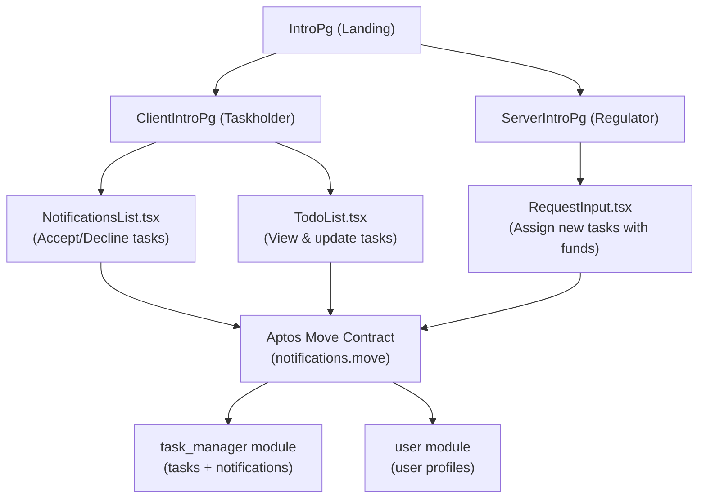

# TrueLedger — Implementation Plan & Bug Fix Guide

> **Project:** Decentralized task/fund allocation system on Aptos blockchain  
> **Stack:** React + TypeScript (Vite) · Aptos Move (smart contracts) · Petra Wallet  
> **Status:** ~40% complete — foundational structure exists, major bugs and missing features remain

---

## Project Architecture Overview



---

## 🔴 Critical Bugs (Fix First)

### Bug 1 — Dual Wallet System Conflict
**Files:** [`WalletContext.tsx`](file:///d:/New%20folder%20(4)/SidFiles/Projectd/DecentralizedVote/client/src/contexts/WalletContext.tsx) & [`main.tsx`](file:///d:/New%20folder%20(4)/SidFiles/Projectd/DecentralizedVote/client/src/main.tsx)

The app has **two competing wallet systems running simultaneously**:
- `main.tsx` wraps the app with `AptosWalletAdapterProvider` (modern SDK)
- `WalletContext.tsx` uses the raw `window.aptos` (old Petra-specific API)
- `ClientIntroPg.tsx` imports `useWallet` from `@aptos-labs/wallet-adapter-react`
- `NotificationService` uses `window.aptos.signAndSubmitTransaction` (old API)

**Fix:** Delete `WalletContext.tsx` entirely. Remove it from `App.tsx`. Use only `useWallet` from `@aptos-labs/wallet-adapter-react` everywhere. The `AptosWalletAdapterProvider` in `main.tsx` is the correct modern approach.

---

### Bug 2 — Old `aptos` Package Used Alongside New `@aptos-labs/ts-sdk`
**Files:** [`TodoList.tsx`](file:///d:/New%20folder%20(4)/SidFiles/Projectd/DecentralizedVote/client/src/components/TodoList.tsx), [`NotificationsList.tsx`](file:///d:/New%20folder%20(4)/SidFiles/Projectd/DecentralizedVote/client/src/components/NotificationsList.tsx), [`RequestInput.tsx`](file:///d:/New%20folder%20(4)/SidFiles/Projectd/DecentralizedVote/client/src/components/RequestInput.tsx), [`transaction.ts`](file:///d:/New%20folder%20(4)/SidFiles/Projectd/DecentralizedVote/client/src/utils/transaction.ts)

```ts
// ❌ Old deprecated SDK — used in 4 files
import { AptosClient, HexString } from 'aptos';
const client = new AptosClient('https://fullnode.devnet.aptoslabs.com/v1');

// ✅ New correct SDK — should be used everywhere
import { Aptos, AptosConfig, Network } from '@aptos-labs/ts-sdk';
const aptos = new Aptos(new AptosConfig({ network: Network.DEVNET }));
```

Old methods that no longer exist or have changed:
| Old (broken) | New equivalent |
|---|---|
| `client.getEventsByEventHandle()` | `aptos.getModuleEventsByEventType()` or indexer queries |
| `client.getAccountResource()` | `aptos.getAccountResource()` |
| `client.waitForTransaction(hash)` | `aptos.waitForTransaction({ transactionHash })` |
| `client.generateTransaction()` | `signAndSubmitTransaction({ data: {...} })` via adapter |

---

### Bug 3 — Event Fetching Will Always Fail
**Files:** [`TodoList.tsx`](file:///d:/New%20folder%20(4)/SidFiles/Projectd/DecentralizedVote/client/src/components/TodoList.tsx#L56-L68), [`NotificationsList.tsx`](file:///d:/New%20folder%20(4)/SidFiles/Projectd/DecentralizedVote/client/src/components/NotificationsList.tsx#L31-L48)

```ts
// ❌ Wrong — event handle path is incorrect, events are #[event] type in Move
const events = await client.getEventsByEventHandle(
  account.address,
  `${moduleAddress}::task_manager::NotificationManager`,
  'NotificationAdded' // wrong field name format
);
```

The Move contract uses `#[event]` struct attributes (modern Aptos event system), NOT the old `EventHandle` pattern. These should be fetched via the Aptos indexer GraphQL API.

**Fix:** Replace with indexer-based event queries using `@aptos-labs/ts-sdk` `aptos.queryIndexer()` or use `aptos.getEvents()`.

---

### Bug 4 — `NotificationService` Uses Non-Existent Contract Functions
**File:** [`notification.ts`](file:///d:/New%20folder%20(4)/SidFiles/Projectd/DecentralizedVote/client/src/services/notification.ts)

The service calls `create_notification`, `mark_as_read`, `delete_notification` — **none of these exist** in the Move contract (`notifications.move`). The contract has `add_notification`, `decline_notification`, `accept_notification`.

Also the `CONFIG.modules.notification` points to `"notification"` module but the Move file defines `task_manager` and `user` modules.

**Fix:** Align `notification.ts` with actual contract function names, or delete and use direct calls in components.

---

### Bug 5 — `ClientIntroPg` Uses `walletAddress` URL Param That Doesn't Exist in Route
**File:** [`ClientIntroPg.tsx`](file:///d:/New%20folder%20(4)/SidFiles/Projectd/DecentralizedVote/client/src/pages/ClientIntroPg.tsx#L21)

```tsx
// In App.tsx — route has no :walletAddress param
<Route path="/clientpg" element={<ClientIntroPg />} />

// In ClientIntroPg.tsx — tries to read walletAddress, always undefined
const { walletAddress } = useParams(); // always undefined!
if (!account || !walletAddress) return; // so fetchUserData never runs
```

**Fix:** Use `account.address` from `useWallet()` instead of `walletAddress` from params. Update `fetchUserData` to use the connected wallet address.

---

### Bug 6 — `NotificationList.tsx` vs `NotificationsList.tsx` Naming Confusion
Two files exist:
- [`NotificationList.tsx`](file:///d:/New%20folder%20(4)/SidFiles/Projectd/DecentralizedVote/client/src/components/NotificationList.tsx) — uses old `NotificationContext` (wrong Notification interface with `message`, `read` fields)
- [`NotificationsList.tsx`](file:///d:/New%20folder%20(4)/SidFiles/Projectd/DecentralizedVote/client/src/components/NotificationsList.tsx) — correct implementation with blockchain calls

`ClientIntroPg.tsx` imports `NotificationList` from `NotificationsList.tsx` which exports `NotificationList`. Meanwhile `NotificationList.tsx` uses `NotificationContext` which calls the broken `NotificationService`.

**Fix:** Delete `NotificationList.tsx` (the one using old context). Keep `NotificationsList.tsx`. Remove `NotificationContext.tsx` and `WalletContext.tsx`.

---

### Bug 7 — `transaction.ts` Uses Old API and Accepts `AptosAccount` (Private Key)
**File:** [`transaction.ts`](file:///d:/New%20folder%20(4)/SidFiles/Projectd/DecentralizedVote/client/src/utils/transaction.ts)

`TransactionHandler.submitTransaction()` requires an `AptosAccount` (private key object) — this is completely wrong for a browser wallet dApp where the wallet signs transactions. This file is entirely unused by the live components (components use `signAndSubmitTransaction` from the adapter) and should be deleted or replaced.

---

### Bug 8 — `config.ts` Points to Mainnet but App Uses Devnet
**File:** [`config.ts`](file:///d:/New%20folder%20(4)/SidFiles/Projectd/DecentralizedVote/client/src/config.ts)

```ts
// ❌ config.ts says mainnet
nodeUrl: "https://fullnode.mainnet.aptoslabs.com",

// ✅ but all components hardcode devnet
const client = new AptosClient('https://fullnode.devnet.aptoslabs.com/v1');
```

Also `notificationStore` resource type references a `::notification::NotificationStore` module that does not exist in the contract.

---

### Bug 9 — `ServerIntroPg` Has No Wallet Connection
**File:** [`ServerIntroPg.tsx`](file:///d:/New%20folder%20(4)/SidFiles/Projectd/DecentralizedVote/client/src/pages/ServerIntroPg.tsx)

The Regulator page only has `RequestInput` but no `WalletSelector`. The Regulator needs to be connected to sign the `add_notification` transaction. Without wallet connection, `RequestInput` silently does nothing (`if (!account) return`).

---

### Bug 10 — `IntroPg` Sign Up Buttons Are Non-Functional
**File:** [`IntroPg.tsx`](file:///d:/New%20folder%20(4)/SidFiles/Projectd/DecentralizedVote/client/src/pages/IntroPg.tsx#L19-L31)

"Not Registered? SignUp" buttons have no `onClick` or `Link`. They render as dead UI elements. The app has no registration flow at all.

---

### Bug 11 — `petra-plugin-wallet-adapter` Deprecated API
**File:** [`main.tsx`](file:///d:/New%20folder%20(4)/SidFiles/Projectd/DecentralizedVote/client/src/main.tsx)

```ts
// ❌ Old v1 pattern
import { PetraWallet } from "petra-plugin-wallet-adapter";
const wallets = [new PetraWallet()];
<AptosWalletAdapterProvider plugins={wallets} ...>

// ✅ Modern @aptos-labs/wallet-adapter-react v6+ uses "optInWallets"
<AptosWalletAdapterProvider optInWallets={["Petra"]} autoConnect={true}>
```

---

### Bug 12 — Money Values in `MoneyCard` and `TodoItem` Are Hardcoded
**File:** [`ClientIntroPg.tsx`](file:///d:/New%20folder%20(4)/SidFiles/Projectd/DecentralizedVote/client/src/pages/ClientIntroPg.tsx#L126-L128)

```tsx
<p><b>Funds Provided:</b> ₹ 1250000</p>  {/* hardcoded */}
<p><b>Tasks Done:</b> 4</p>               {/* hardcoded */}
<MoneyCard title="Funds Used" percentage={1.2} amount={15000} />  {/* hardcoded */}
```

These should be computed from the fetched task data.

---

## 🟡 Missing Features (Incomplete)

### Missing Feature 1 — `ServerIntroPg` (Regulator Dashboard) Is Mostly Empty
The Regulator page only renders a title and `RequestInput`. It's missing:
- Wallet connection (WalletSelector)
- View list of all sent notifications and their statuses
- View all Taskholders and their task completion metrics
- Admin authentication / access control

### Missing Feature 2 — User Registration Flow
- "Not Registered? SignUp" does nothing
- No registration form/page exists
- The `create_user` function in the contract has hardcoded `name = "John Doe"` and `field = "Healthcare"` — there's no way for a user to set their own name/field

### Missing Feature 3 — No Real-Time Updates (WebSocket/Subscription)
Both `TodoList` and `NotificationsList` poll every 10 seconds with `setInterval`. This is inefficient. The Aptos ecosystem supports indexer subscriptions via GraphQL for real-time updates.

### Missing Feature 4 — Fund Tracking is Not Wired
`MoneyCard` shows hardcoded fund data. The contract tracks `money_allocated` per task but the frontend never aggregates this into totals.

### Missing Feature 5 — No Error Boundary / Global Error Handling
Errors in blockchain calls only show inline in specific components. No global toast notifications or error boundary.

### Missing Feature 6 — No Route Protection
Both `/clientpg` and `/serverpg` are accessible without wallet connection. Should redirect to wallet connect if not connected.

### Missing Feature 7 — `NotificationContext` / `NotificationService` Disconnected from UI
`NotificationContext.tsx` and `NotificationService.ts` were built as a service layer but are never used by the actual working components. The components do their own direct blockchain calls. This architecture should be unified.

---

## ✅ Implementation Plan (Phased)

### Phase 1 — Critical Bug Fixes (Day 1-2)

**Step 1.1 — Unify Wallet to Modern SDK**
1. Delete [`WalletContext.tsx`](file:///d:/New%20folder%20(4)/SidFiles/Projectd/DecentralizedVote/client/src/contexts/WalletContext.tsx)
2. Delete [`NotificationContext.tsx`](file:///d:/New%20folder%20(4)/SidFiles/Projectd/DecentralizedVote/client/src/contexts/NotificationContext.tsx)
3. Delete [`transaction.ts`](file:///d:/New%20folder%20(4)/SidFiles/Projectd/DecentralizedVote/client/src/utils/transaction.ts)
4. Delete [`notification.ts`](file:///d:/New%20folder%20(4)/SidFiles/Projectd/DecentralizedVote/client/src/services/notification.ts)
5. Delete [`NotificationList.tsx`](file:///d:/New%20folder%20(4)/SidFiles/Projectd/DecentralizedVote/client/src/components/NotificationList.tsx) (old one)
6. Update `App.tsx` — remove `WalletProvider` and `NotificationProvider` wrappers

**Step 1.2 — Fix `main.tsx` Wallet Provider**
```tsx
// Replace plugins={wallets} with optInWallets
<AptosWalletAdapterProvider optInWallets={["Petra"]} autoConnect={true}>
```

**Step 1.3 — Create Shared `aptosClient.ts`**
```ts
// src/lib/aptosClient.ts
import { Aptos, AptosConfig, Network } from '@aptos-labs/ts-sdk';
export const MODULE_ADDRESS = "0x3c6d41e6d9cb82e798e861606d8ef50f90b6aedb1ef66e97c33f8879013bce6b";
export const aptos = new Aptos(new AptosConfig({ network: Network.DEVNET }));
```

Replace all `new AptosClient(...)` instances in all 4 components with this shared client.

**Step 1.4 — Fix `ClientIntroPg` wallet address**
```tsx
// Replace:
const { walletAddress } = useParams();
if (!account || !walletAddress) return;

// With:
const { account } = useWallet();
const walletAddress = account?.address;
if (!account) return;
```

**Step 1.5 — Fix Event Fetching (Critical)**

Replace old `getEventsByEventHandle` with modern indexer queries:
```ts
// Fetch #[event] struct events via indexer
const events = await aptos.queryIndexer({
  query: {
    resource_type: `${MODULE_ADDRESS}::task_manager::TaskCreated`,
    account_address: account.address,
  }
});
```

Or use `aptos.getAccountEventsByEventType()` from the new SDK.

**Step 1.6 — Fix `config.ts`**
```ts
export const CONFIG = {
  network: {
    nodeUrl: "https://fullnode.devnet.aptoslabs.com/v1",
  },
  moduleAddress: "0x3c6d41e6d9cb82e798e861606d8ef50f90b6aedb1ef66e97c33f8879013bce6b",
  modules: {
    taskManager: "task_manager",
    user: "user",
  },
};
```

---

### Phase 2 — Complete ServerIntroPg / Regulator Dashboard (Day 2-3)

**Step 2.1 — Add Wallet Selector to Regulator page**
```tsx
// In ServerIntroPg.tsx navbar
<WalletSelector />
```

**Step 2.2 — Build Regulator Dashboard UI**
Create `RegulatorDashboard.tsx` component showing:
- List of sent notifications with status (Pending/Accepted/Declined)
- Summary stats: total funds allocated, tasks completed, tasks in progress
- `RequestInput` for sending new tasks

**Step 2.3 — Fetch Notification Events on Regulator Side**
The Regulator (admin) emits `NotificationAdded` events. Fetch those from their account address and display them in a table.

---

### Phase 3 — User Registration & Profile (Day 3)

**Step 3.1 — Update `create_user` in Move Contract**
The contract currently hardcodes `"John Doe"` and `"Healthcare"`. Add parameters:
```move
public entry fun create_user(account: &signer, name: String, field: String) {
    // ...use passed name and field instead of hardcoded values
}
```
Redeploy to devnet.

**Step 3.2 — Build Registration Form**
Create a `RegisterModal.tsx` or `RegisterPage.tsx` with:
- Name input
- Field/sector dropdown (Healthcare, Infrastructure, Education, etc.)
- Submit calls `create_user` with these values

**Step 3.3 — Wire SignUp Buttons in `IntroPg`**
```tsx
// IntroPg.tsx — add state and modal
const [showRegisterModal, setShowRegisterModal] = useState(false);
<button onClick={() => setShowRegisterModal(true)}>Not Registered? SignUp</button>
```

---

### Phase 4 — Live Fund Tracking (Day 4)

**Step 4.1 — Compute Fund Totals from Task Events**
In `ClientIntroPg.tsx`, after fetching tasks, compute:
```ts
const totalFunds = tasks.reduce((sum, t) => sum + t.moneyAllocated, 0);
const completedFunds = tasks
  .filter(t => t.status === 'Completed')
  .reduce((sum, t) => sum + t.moneyAllocated, 0);
const percentage = totalFunds > 0 ? (completedFunds / totalFunds) * 100 : 0;
```
Pass these to `MoneyCard`.

**Step 4.2 — Replace hardcoded stats**
Remove hardcoded `₹ 1250000`, `4 tasks`, replace with computed values from fetched tasks.

---

### Phase 5 — UX & Routing Improvements (Day 4-5)

**Step 5.1 — Add Route Protection**
```tsx
// Create ProtectedRoute component
const ProtectedRoute = ({ children }) => {
  const { connected } = useWallet();
  if (!connected) return <Navigate to="/" />;
  return children;
};

// In App.tsx
<Route path="/clientpg" element={<ProtectedRoute><ClientIntroPg /></ProtectedRoute>} />
<Route path="/serverpg" element={<ProtectedRoute><ServerIntroPg /></ProtectedRoute>} />
```

**Step 5.2 — Add Toast Notifications**
Install `react-hot-toast` or `sonner` for user-friendly transaction feedback:
```
pnpm add sonner
```
Replace all `alert()` calls and raw error displays with toast notifications.

**Step 5.3 — Add Error Boundaries**
Wrap main routes in a `React.ErrorBoundary` to catch unexpected errors gracefully.

---

### Phase 6 — Move Contract Improvements (Day 5)

**Step 6.1 — Add View Functions for UI Querying**
The current Move contract has no `#[view]` functions. Add them so the frontend can query data without using events:
```move
#[view]
public fun get_all_tasks(addr: address): vector<Task> acquires TaskManager {
    // return tasks as a vector
}

#[view]  
public fun get_task_count(addr: address): u64 acquires TaskManager {
    borrow_global<TaskManager>(addr).task_counter
}
```

This solves the event-fetching problem entirely — query resources directly via `aptos.view()`.

**Step 6.2 — Fix Module Name in `Move.toml`**
The package is named `"notification"` but defines modules `user` and `task_manager`. Rename to `"trueledger"` for clarity.

**Step 6.3 — Add Access Control for Regulator**
Currently anyone can call `add_notification`. Add an admin address check or use a capability pattern.

---

### Phase 7 — Polish (Day 5-6)

- [ ] Add loading skeletons instead of text "Loading..."
- [ ] Make `TodoList` and `NotificationsList` responsive on mobile
- [ ] Add empty states with illustrations
- [ ] Fix `ServerIntroPg` title ("Server Intro page" → "Regulator Dashboard")
- [ ] Add proper TypeScript types, remove all `any` usage
- [ ] Update README with current project state and setup instructions

---

## 📁 Files to Delete

| File | Reason |
|---|---|
| `src/contexts/WalletContext.tsx` | Replaced by `@aptos-labs/wallet-adapter-react` |
| `src/contexts/NotificationContext.tsx` | Service layer disconnected from actual UI |
| `src/services/notification.ts` | Calls non-existent contract functions |
| `src/utils/transaction.ts` | Uses old API, requires private key |
| `src/components/NotificationList.tsx` | Duplicate (wrong), uses old context |

## 📁 Files to Create

| File | Purpose |
|---|---|
| `src/lib/aptosClient.ts` | Single shared Aptos client + module address |
| `src/components/RegisterModal.tsx` | User registration form |
| `src/components/ProtectedRoute.tsx` | Route guard for wallet connection |
| `src/components/RegulatorDashboard.tsx` | Full regulator view |
| `src/components/Toast.tsx` | Toast notification wrapper |

## 📁 Files to Fix

| File | Changes Needed |
|---|---|
| `main.tsx` | Replace `plugins` API with `optInWallets` |
| `App.tsx` | Remove old providers, keep only `AptosWalletAdapterProvider` |
| `config.ts` | Fix network URL, remove non-existent resource types |
| `ClientIntroPg.tsx` | Fix `walletAddress` param, use computed fund data |
| `ServerIntroPg.tsx` | Add wallet selector, add regulator dashboard |
| `IntroPg.tsx` | Wire SignUp buttons to registration flow |
| `TodoList.tsx` | Replace `AptosClient` with new SDK, fix event fetching |
| `NotificationsList.tsx` | Replace `AptosClient` with new SDK, fix event fetching |
| `RequestInput.tsx` | Replace `AptosClient` with new SDK |
| `notifications.move` | Add `#[view]` functions, add `name`/`field` params to `create_user`, rename package |

---

## Dependency Audit

```json
// REMOVE from package.json:
"aptos": "^1.21.0"          // ← old deprecated SDK

// KEEP:
"@aptos-labs/ts-sdk": "^1.32.0"          // ← new SDK
"@aptos-labs/wallet-adapter-react": "^6.1.1"  // ← wallet adapter

// ADD:
"sonner": "latest"           // or "react-hot-toast" for toasts
```

> [!WARNING]
> The `aptos` (v1) and `@aptos-labs/ts-sdk` packages conflict in types. Having both installed causes TypeScript errors. Remove `aptos` from `package.json` completely.

> [!IMPORTANT]
> The Move contract at address `0x3c6d41e6d9cb82e798e861606d8ef50f90b6aedb1ef66e97c33f8879013bce6b` needs to be **redeployed to devnet** after adding `#[view]` functions and updating `create_user` parameters. The existing build artifacts in `contracts/build/` are from an older version.

> [!NOTE]
> The project's original README describes a "Decentralized Voting System" with voter identity verification and political parties, but the codebase has pivoted to a "Task/Fund Allocation" system (TrueLedger). The README should be updated to reflect the actual implemented system.
