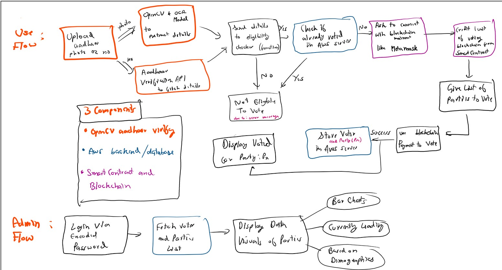

# Decentralized Voting System

This project aims to develop a secure, transparent, and decentralized voting system leveraging blockchain technology and cloud services.

---

## Features

1. **Cloud Storage with AWS**  
   - Votes are securely stored in AWS, ensuring scalability and reliability.

2. **Concurrency and Live Updates**  
   - Ensure a seamless voting experience for users with real-time updates for administrators.

3. **Custom Blockchain Currency**  
   - Implement a smart contract to create a unique blockchain currency.  
   - Each user receives **1 token** to cast their vote.

4. **Transaction-Based Voting System**  
   - A simple transaction mechanism for casting votes on the blockchain.

5. **Vote Retraction and Refunds**  
   - Users can retract their votes and get their currency refunded.

6. **Cross-Platform GUI**  
   - Develop a mobile app using **React Native** or **Flutter** for user convenience.  
   - If mobile support is not feasible, create a web-based GUI with **React** and deploy it on **Vercel**.

7. **Eligibility Verification**  
   - Use government-issued IDs (e.g., Aadhaar card, passport, PAN card) for validation.
---

## User Flow

### Steps:

1. **Identity Verification**  
   - Upload an image of a government document containing:  
     - Government ID Number  
     - Date of Birth  
     - Nationality  
   - Extract details using OpenCV and OCR model and verify:  
     - Age ≥ 18 years  
     - Nationality is India  
   - **Privacy Assurance**: The uploaded image will **not be stored** in the database.

2. **Connect to Blockchain**  
   - Ask the user to connect to the blockchain mainnet using **MetaMask** (or an alternative tool).

3. **Assign Voting Token**  
   - Add 1 token of the custom blockchain currency to the user's MetaMask wallet.

4. **Voting**  
   - Allow the user to vote for one of 4–5 predefined parties.

5. **Store Vote**  
   - Record the vote along with the user's demographics in AWS.

6. **Confirmation**  
   - Display a success message once the vote is submitted.

## Admin Flow

### Steps:

1. **Login**  
   - Enter a **UTH-18** encoded password string to access the admin dashboard.

2. **View Results**  
   - Use data visualizations to display voting results.

3. **Live Dashboard**  
   - Real-time tracking of the leading party.

4. **Demographics Analysis**  
   - Breakdown of votes by:  
     - Gender (Male/Female)  
     - State (if applicable)

## Project Flow

