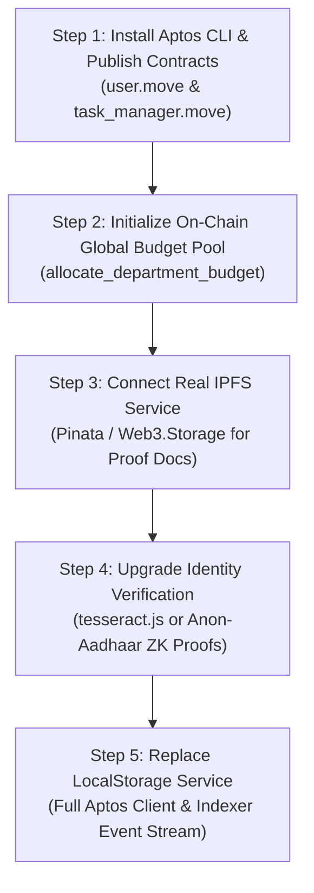

# TrueLedger: Audit of Mock Implementations & Production Roadmap

This audit reviews every simulated, mock, and local storage fallback implementation currently present across the TrueLedger application and specifies the concrete architecture, Move contracts, and SDK integrations required to replace them with production systems.

---

## Executive Summary Matrix

| # | Component / Domain | Current Implementation (Mock / Fallback) | Target Production Implementation | Priority |
|---|-------------------|------------------------------------------|----------------------------------|----------|
| **1** | **Smart Contract Deployment & State** | Local memory cache in `taskLedgerService.ts` + `localStorage` (`trueledger_tasks_v3`) with mock tx fallback | Compiled & published Move bytecode on Aptos Devnet/Mainnet with Aptos Indexer / GraphQL sync | **Critical (P0)** |
| **2** | **Proof Document Storage (IPFS)** | In-browser Base64 Data URL via `FileReader` + mock CID (`ipfs://bafybeicg7e2m5...`) | Real decentralized pinning via Pinata / Web3.Storage (`w3up-client`) with IPFS gateway resolution | **High (P1)** |
| **3** | **Regulator Identity & Aadhaar Verification** | Simulated OpenCV + Tesseract OCR timer (`setTimeout`) with hardcoded profile data in `AadhaarVerificationModal.tsx` | Client-side `tesseract.js` OCR or Zero-Knowledge Anon-Aadhaar verification (`@anon-aadhaar/react`) | **High (P1)** |
| **4** | **Taskholder Profile & Identity** | Client falls back to `localStorage.getItem('trueledger_user_<addr>')` and empty `create_user()` | Call `user::create_user_with_info(name, field)` on-chain; query profile via `aptos.view()` | **Medium (P2)** |
| **5** | **Multi-Regulator Synchronized Treasury** | In-memory `MACRO_BUDGETS` updated across browser tabs via `taskLedgerService` | Shared on-chain `GlobalBudgetPool` resource in `task_manager.move` with single source of truth | **High (P1)** |
| **6** | **Decentralized Task Broadcast & Notifications** | Local event emitter in `taskLedgerService` with `Broadcast Scope: ALL` | On-chain event listener on `NotificationAdded` and `TaskCreated` via Aptos Indexer / Event Stream | **Medium (P2)** |

---

## Detailed Audit Breakdown

### 1. Smart Contract Deployment & On-Chain State Sync
- **Current Mock / Fallback:**
  - `taskLedgerService.ts` maintains tasks (`INITIAL_TASKS`) and department allocations (`MACRO_BUDGETS`) in browser storage.
  - When Petra wallet submits `approve_task` or `return_surplus`, a preflight check (`aptos.getAccountModule`) detects if the module is published. If the module is not yet published on the active network epoch, a mock 64-char transaction hash `0x...` is generated to prevent the user flow from stalling.
- **Root Cause:**
  - The Aptos CLI is not installed in the system PATH, so `contracts/sources/task_manager.move` and `contracts/sources/user.move` have not yet been published to the module address (`0x3c6d41e6d9cb82e798e861606d8ef50f90b6aedb1ef66e97c33f8879013bce6b`).
- **Production Replacement Plan:**
  1. Install Aptos CLI (`winget install Aptos.AptosCli` or binary download).
  2. Run `aptos init --network devnet` using the deployer private key.
  3. Publish contracts:
     ```bash
     cd contracts
     aptos move compile
     aptos move publish --named-addresses account_addr=0x3c6d41e6d9cb82e798e861606d8ef50f90b6aedb1ef66e97c33f8879013bce6b
     ```
  4. Initialize global pool via entry function `task_manager::initialize_global_ledger(admin)`.
  5. Replace `taskLedgerService.ts` local cache queries with Aptos client calls:
     ```typescript
     const pool = await aptos.getAccountResource({
       accountAddress: MODULE_ADDRESS,
       resourceType: `${MODULE_ADDRESS}::task_manager::GlobalBudgetPool`,
     });
     ```

---

### 2. Proof of Work Document Storage (IPFS)
- **Current Mock / Fallback:**
  - In `TaskProofSubmissionModal.tsx`, when a taskholder uploads a PDF/Word document, `FileReader.readAsDataURL()` converts the file to a base64 string stored in the browser.
  - The IPFS CID is generated as a mock placeholder (`ipfs://bafybeicg7e2m56v2q3o7x...`).
- **Production Replacement Plan:**
  1. Integrate Pinata or Web3.Storage API in `client/src/services/ipfsService.ts`.
  2. Upload workflow:
     ```typescript
     export async function uploadProofToIPFS(file: File): Promise<{ cid: string; gatewayUrl: string }> {
       const formData = new FormData();
       formData.append('file', file);
       const res = await fetch('https://api.pinata.cloud/pinning/pinFileToIPFS', {
         method: 'POST',
         headers: { Authorization: `Bearer ${PINATA_JWT}` },
         body: formData,
       });
       const data = await res.json();
       return {
         cid: data.IpfsHash,
         gatewayUrl: `https://gateway.pinata.cloud/ipfs/${data.IpfsHash}`,
       };
     }
     ```
  3. Submit the true IPFS CID to the blockchain via `task_manager::submit_task_proof(account, task_id, actual_spent, cid)`.
  4. In `TaskAuditModal.tsx`, inspect the document directly via the immutable IPFS gateway URL.

---

### 3. Regulatory Identity & Aadhaar Verification (OCR)
- **Current Mock / Fallback:**
  - `AadhaarVerificationModal.tsx` simulates OpenCV preprocessing and Tesseract OCR with `setTimeout` delays and seeds mock profile data (`Shri Vikramaditya Sharma`, DOB `1985-08-15`, Aadhaar `5421 8904 1238`).
  - Stores authority verification in `localStorage.getItem('trueledger_verified_authority')`.
- **Production Replacement Plan:**
  - **Option A (Zero-Knowledge Privacy - Recommended):** Integrate **Anon-Aadhaar** (`@anon-aadhaar/react`).
    - Taskholders and regulators generate a cryptographic ZK-SNARK proof verifying they possess a valid Indian Aadhaar signed by UIDAI, without revealing their Aadhaar number or address.
    - Submit the ZK proof on-chain to verify the regulator's authority.
  - **Option B (Client-Side In-Browser OCR):**
    - Install `tesseract.js` in client: `npm i tesseract.js`.
    - Run OCR on the uploaded document inside the browser (zero server transmission).
    - Parse standard Indian Government ID regular expressions (e.g. `\d{4}\s\d{4}\s\d{4}` for Aadhaar or `[A-Z]{5}[0-9]{4}[A-Z]{1}` for PAN) and check date of birth for 18+ requirement.

---

### 4. Taskholder Profile & User Resource
- **Current Mock / Fallback:**
  - In `ClientIntroPg.tsx`, user identity checks query `aptos.getAccountResource` for `${MODULE_ADDRESS}::user::User`.
  - When the module is unavailable, it reads from `localStorage.getItem('trueledger_user_<addr>')`.
  - When creating a profile, it was calling `create_user` (which defaults to "John Doe") and saving custom names only in `localStorage`.
- **Production Replacement Plan:**
  1. Call the newly created `user::create_user_with_info(account, name, field)` entrypoint:
     ```typescript
     const tx: InputTransactionData = {
       data: {
         function: `${MODULE_ADDRESS}::${MODULES.user}::create_user_with_info`,
         functionArguments: [finalName, finalField],
       },
     };
     await signAndSubmitTransaction(tx);
     ```
  2. Use Aptos View functions (`user::get_name`, `user::get_field`, `user::user_exists`) to fetch profile data directly from chain state.

---

### 5. Multi-Regulator Shared Department Budget Pool
- **Current Mock / Fallback:**
  - Department budget numbers (`Healthcare: ₹2,00,000`, `Infrastructure: ₹4,00,000`, etc.) and multi-regulator deduction syncs are currently managed by `taskLedgerService.ts` in browser storage.
- **Production Replacement Plan:**
  - Move module `contracts/sources/task_manager.move` already defines:
    ```move
    struct DepartmentPool has store {
        sector: String,
        total_budget: u64,
        committed_funds: u64,
        disbursed_funds: u64,
    }
    struct GlobalBudgetPool has key {
        pools: Table<String, DepartmentPool>,
        admin: address,
    }
    ```
  - Upon contract publish, the admin executes `allocate_department_budget(admin, sector, total_budget)`.
  - When any regulator calls `add_notification` or `approve_task`, the smart contract updates `committed_funds` and `disbursed_funds` in `GlobalBudgetPool`.
  - All regulators fetch the identical department pool balance directly from the resource on chain.

---

### 6. Decentralized Event Ingestion (Aptos Indexer)
- **Current Mock / Fallback:**
  - Changes are published locally using `taskLedger.subscribe(callback)`.
- **Production Replacement Plan:**
  - Use Aptos Event Polling or the Aptos Indexer GraphQL endpoint:
    ```graphql
    query GetDepartmentEvents($address: String!) {
      events(
        where: { account_address: { _eq: $address }, indexed_type: { _like: "%task_manager::%" } }
        order_by: { transaction_version: desc }
      ) {
        data
        type
        transaction_version
      }
    }
    ```
  - Automatically updates the notification bell and active task lists in real time when peer regulators or taskholders perform actions.

---

## Action Plan: Recommended Implementation Order



# TrueLedger: Codebase Cleanup & Deprecation Checklist

This checklist identifies all dead files, legacy prototype components, redundant re-export shims, and obsolete mock data that should be removed to achieve a clean, production-ready codebase.

---

## 1. Dead & Orphaned Files (Safe for Immediate Deletion)

These files are completely unused, commented out, or remnants of early prototypes:

| Path | Description | Reason for Removal |
| :--- | :--- | :--- |
| `client/src/components/Navbar.tsx` | Old placeholder navigation component (100% commented out). | Superseded by responsive in-page navbars in `ClientIntroPg.tsx`, `ServerIntroPg.tsx`, and `LeaderboardPg.tsx`. |
| `client/src/components/Contact.tsx` | Unused contact form stub. | Not imported by any route or component in the app. |
| `client/src/components/User/Dashboard.tsx` | Early prototype user dashboard with mock tabs. | Replaced by `ClientIntroPg.tsx` and `ServerIntroPg.tsx`. |
| `client/src/components/User/Tasks.tsx` | Early prototype task list. | Replaced by `TodoList.tsx` and `TodoItem.tsx`. |
| `client/src/components/data/index.ts` | Static mock array (`taskList` with "Doctor Appointment", "Call Plumber"). | Not imported anywhere; superseded by `taskLedgerService.ts`. |
| `about.md` (root directory) | Raw text copy of the initial project brief. | Informational notes superseded by the Master Phase Plan and Audit reports in documentation. |

---

## 2. Redundant Folder & Re-Export Shims (`components/` vs `utlis/`)

Early in the project, a misspelled directory `client/src/utlis/` was created. Later, 2-line re-export files were placed in `client/src/components/` to forward to `utlis/`:

- `client/src/components/MoneyCard.tsx` ➔ re-exports from `../utlis/MoneyCard`
- `client/src/components/NotificationsList.tsx` ➔ re-exports from `../utlis/NotificationsList`
- `client/src/components/RequestInput.tsx` ➔ re-exports from `../utlis/RequestInput`
- `client/src/components/TodoItem.tsx` ➔ re-exports from `../utlis/TodoItem`
- `client/src/components/TodoList.tsx` ➔ re-exports from `../utlis/TodoList`

### Recommended Cleanup:
1. Move the real components from `client/src/utlis/` directly into `client/src/components/`.
2. Delete the redundant 2-line re-export shims.
3. Remove the misspelled `client/src/utlis/` directory entirely.

---

## 3. Legacy Contracts Cleaned in Git

Verify that the old monolithic Move contracts are fully purged from version control:
- `contracts/sources/notifications.move` (Deleted ✓ — superseded by `contracts/sources/task_manager.move`)
- `contracts/sources/todolist.move` (Deleted ✓ — superseded by `contracts/sources/task_manager.move` & `user.move`)
- `client/src/utlis/task/NotificationContext.tsx` & `TaskContext.tsx` (Deleted ✓)

---

## 4. Hardcoded Mock Data & Fallback Flags

Before final production launch:

1. **`INITIAL_TASKS` in `taskLedgerService.ts`**:
   - Currently seeds 3 pre-filled dummy tasks ("Deliver Medical Supplies", "Construct Primary Healthcare Wing", "Solar Array Installation") into `localStorage`.
   - **Production Action:** Gate behind an environment check (`import.meta.env.VITE_USE_MOCK_LEDGER === 'true'`). In production mode, initialize with an empty array `[]` and fetch exclusively from chain state.
2. **`MACRO_BUDGETS` Hardcoded Seed**:
   - Currently hardcodes initial departmental budget percentages (`Healthcare: 12%`, `Infrastructure: 24%`, etc.).
   - **Production Action:** In production, budgets should be populated exclusively from the Level 1 Budget Allocator's on-chain allocation transaction (`task_manager::allocate_department_budget`).
3. **Simulated Hash Fallbacks (`0x...`)**:
   - Once the Move modules are published on Devnet/Mainnet, remove the fallback mock hash generator so transactions strictly reflect true on-chain transactions or fail visibly with Petra wallet feedback.

---

## 5. UI Elements to Deprecate

1. **Target Taskholder Wallet Address Inputs**:
   - Completely remove any remaining raw address inputs in task creation forms to preserve zero-knowledge anti-corruption privacy.
2. **"Not Registered? Sign Up" vs Direct Wallet Auth**:
   - In [`IntroPg.tsx`](file:///d:/New%20folder%20(4)/SidFiles/Projectd/DecentralizedVote/client/src/pages/IntroPg.tsx), having both "Login" and "Not Registered? Sign Up" buttons causes confusion since Aptos authentication is wallet-driven. Simplify to single "Connect Wallet & Enter Portal" action that automatically detects registration on-chain.
